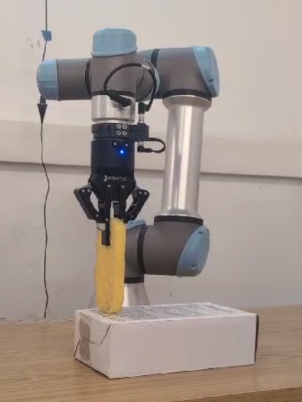
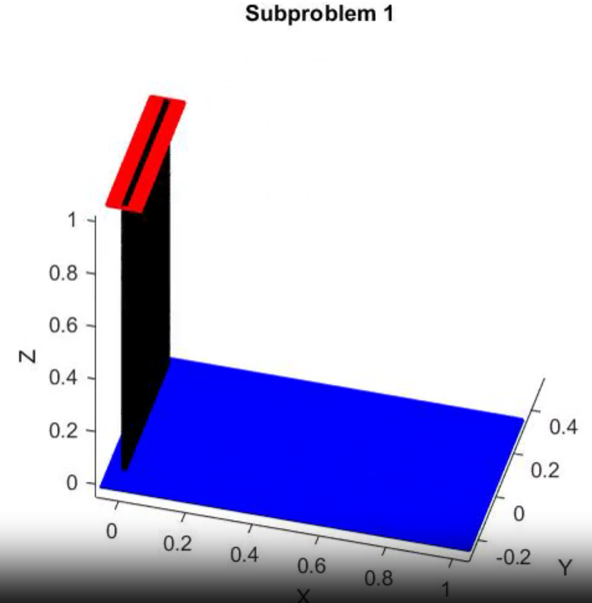
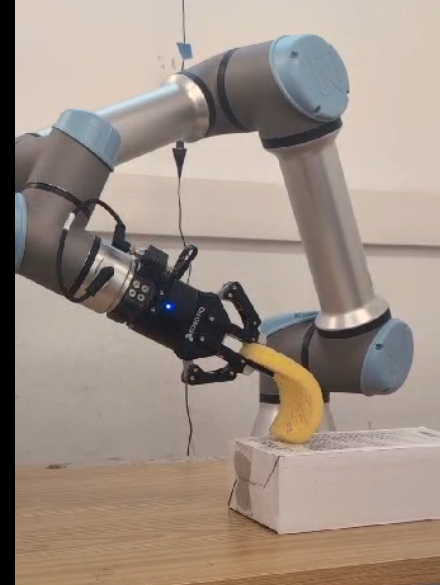
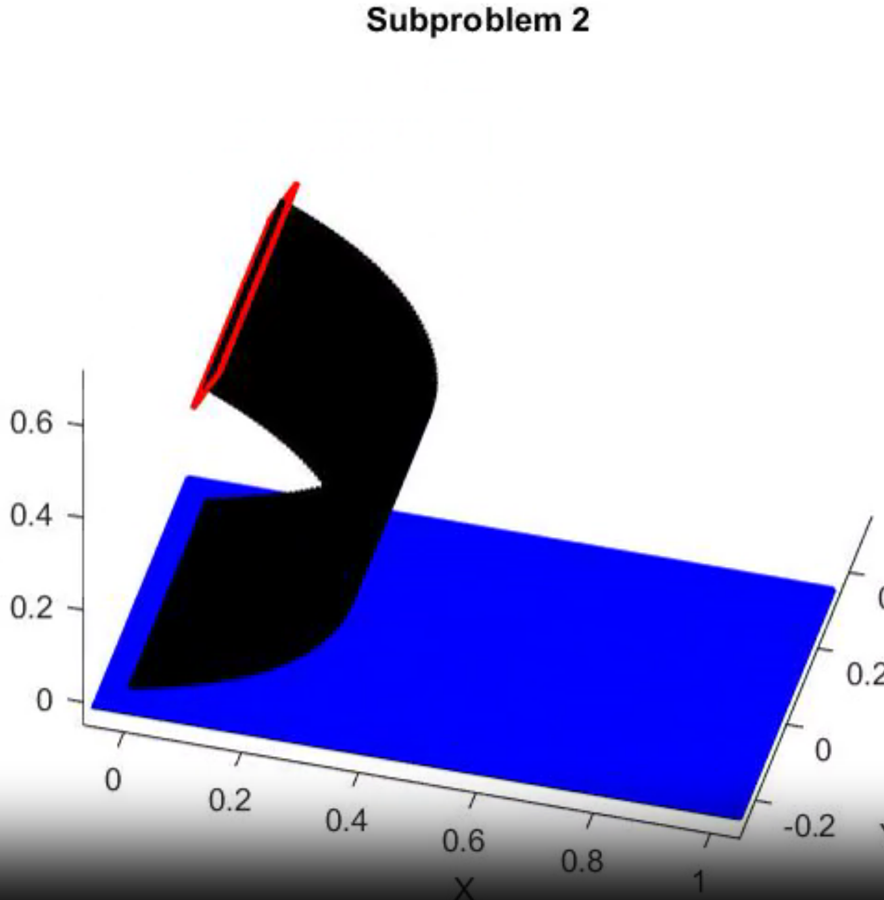
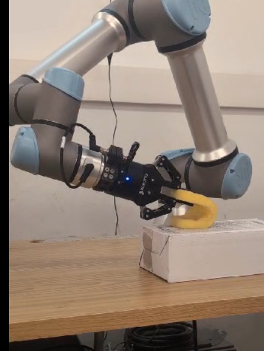
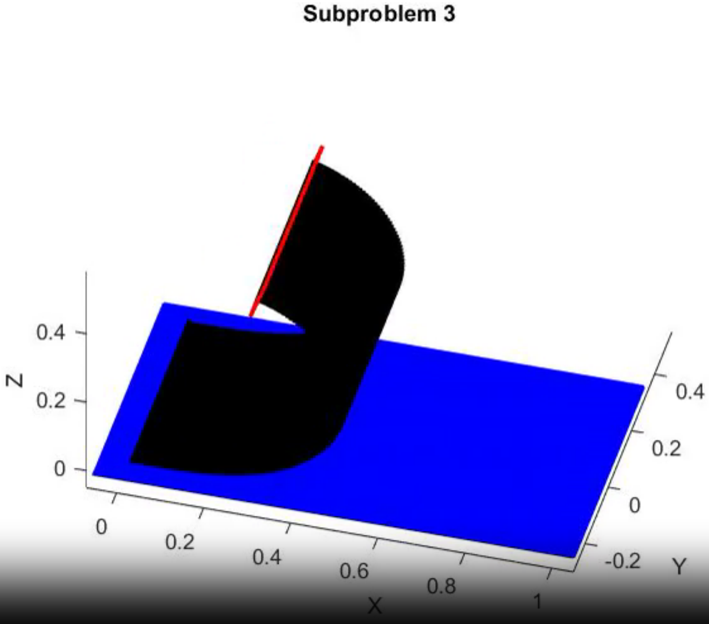
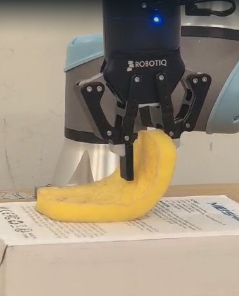
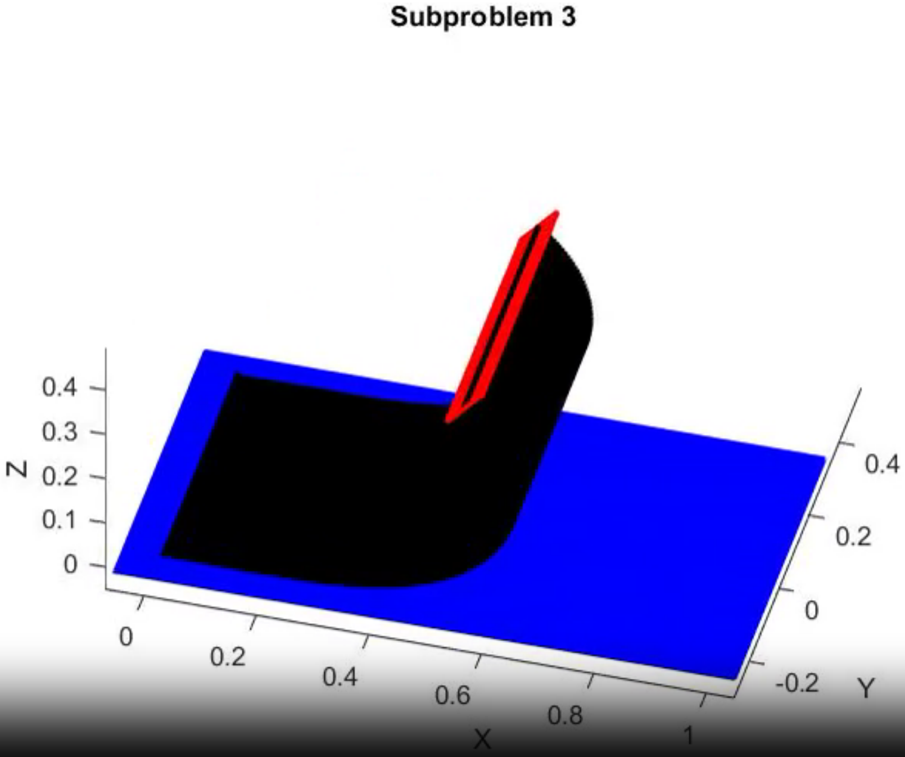
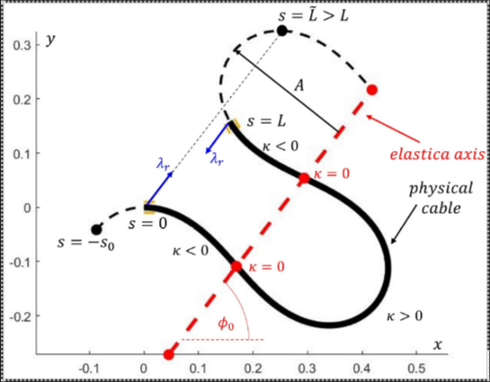

# Displacement-Flexible-Linear-Objects-Technion
In this repository, you will find Python program and documentation of the displacement process.

<!--video of simulation-->

<b><i>The displacement process</i></b>

<video src="https://github.com/user-attachments/assets/bf3fd472-4bab-492f-893b-39e2a46ccf40
" alt="" width="33%">

<b>Itay Grinberg & Aharon Levin</b>
 
<a href="mailto:itaygrinberg@campus.technion.ac.il" target="_top">itaygrinberg@campus.technion.ac.il</a>

<a href="mailto:aharon.levin@campus.technion.ac.il" target="_top">aharon.levin@campus.technion.ac.il</a>

<b>Guidance: Elon Rimon</b>
 
<a href="mailto:rimon@me.technion.ac.il" target="_top">rimon@me.technion.ac.il</a>

------------

### Contents
1. [Introduction](#1.0)
2. [Environment Setup + Code Documentation](#2.0)
3. [Theoretical Background](#3.0)
4. [Testing and Review](#4.0)

------------

### Abbreviations

* **DOF** &nbsp;&nbsp;&nbsp;&nbsp;&nbsp; [Degrees Of Freedom](https://en.wikipedia.org/wiki/Degrees_of_freedom_(mechanics))
* **DO** &nbsp;&nbsp;&nbsp;&nbsp;&nbsp; [Deformable Object](https://en.wikipedia.org/wiki/Soft-body_dynamics)
* **EE** &nbsp;&nbsp;&nbsp;&nbsp;&nbsp;&nbsp;&nbsp;&nbsp; [End-Effector](https://en.wikipedia.org/wiki/Robot_end_effector)
* **DH** &nbsp;&nbsp;&nbsp;&nbsp;&nbsp;&nbsp;&nbsp;&nbsp;&nbsp;[Denavit–Hartenberg](https://en.wikipedia.org/wiki/Denavit%E2%80%93Hartenberg_parameters)
* **FK** &nbsp;&nbsp;&nbsp;&nbsp;&nbsp;&nbsp;&nbsp;&nbsp; [Forward Kinematics](https://en.wikipedia.org/wiki/Forward_kinematics)
* **IK** &nbsp;&nbsp;&nbsp;&nbsp;&nbsp;&nbsp;&nbsp;&nbsp;&nbsp; [Inverse Kinematics](https://en.wikipedia.org/wiki/Inverse_kinematics)
* **URDF** &nbsp;&nbsp;&nbsp; [Unified Robot Description Format](http://wiki.ros.org/urdf)
* **UR5E** &nbsp;&nbsp;&nbsp;&nbsp;&nbsp; [UR5E](https://www.universal-robots.com/products/ur5-robot?utm_source=Other&utm_medium=referral&utm_content=Qviro&utm_campaign=HQ_HQ_QviroTest2023&qviroGID=GA1.2.379176904.1721031028&utm_leadsource=Referral&utm_term=Qviro)

------------

### 1. Introduction

The proposed repository focuses on the three subproblems of the displacement process.  For the development of this Python library, we used the **elastica** as our model, which is explained in detail below.  

##### Objective

In order to place the DO effectively, precise manner and without damage or distortions, we need to make a controlled and well-planned movement.
As part of our work, we proposed a novel approach to shape control of deformable elongated linear objects which could have potential applications in the handling of fish.
This is a challenging problem since it requires an online analysis of the current setting of the environment and the current capabilities of the agent. In addition, it requires an integration of high-level task planning and low-level motion planning. 

Within the context of this, the displacement cycle can be divided into the following tasks:

* Bring the DO from the transportation process target to the stabbing point with the tray.
* Getting the DO ready for rolling so that its edge does not slip from the tray and the tray does not slip on the surface.
* Pure rolling of the DO until it is placed.

##### Relevance
Manipulation of flexible cables is relevant to both industrial and household environments. 

------------

<!--

   2. Environment Setup<a href="#top">Back to Top</a>

-->
### 2. Environment Setup + Code Documentation
#### 2.1 Environment Setup
The project uses ROS2 Humble Hawksbill running on Ubuntu 22.04 LTS (Jammy Jellyfish) and Python 3.10.

#### 2.2 Code Documentation
The framework code is the pipeline of the planner, “main.py”. In this file the user defines all the variables and the parameters given as **inputs**, it could be an auto script that reads the callbacks like sensor or the camera and fills in the fields. For example, the URDF of the robot, physical properties of the object like length, friction coefficient etc. After that the planner, which is described later, is called and returns as path planning trajectory. In addition, the trajectory is very noisy, so we smooth it. In the end, we get as **outputs** the **robot joints pose** and **figures of linear object path**. 
The pipeline of the script performs the following: 

  1. Definition of all the input of the problem – by the user or by callbacks
 **Input**: URDF (robot model), start position, target positions, friction coefficients, tray hight, direction of rolling. 
  3. Defines the boundaries of the problem based on the inputs. It’s including the robot model. 
  4. Computes the trajectory for sub-problem one. 
  5. Computes the trajectory for sub-problem two. 
  6. Computes the trajectory for sub-problem three. 
    During the path check we make sure the path in valid in terms of C-space and IK. 
  7. Make a smooth trajectory. We can decide how smooth it can be.
  8. Computes the position and orientation of the EE
  9. Returns the total trajectory.
    **Output**: total trajectory, robot joint positions.

The planner, “dispalcement.py” file, consists of three parts, the division was defined according to the three sub-problems: sub-problem one is to take the object to the “stabbing point” which is the first point the object touches the tray. The input is the object's current position, and the target is the “stabbing point”. 

 
<b>Fig. 1&nbsp;&nbsp;At the right the releasing point at the simulation. At the left the releasing point on the real robot</b>

As part of sub-problem two, we plan the trajectory of the gripper as the object bends so that it stays on the tray only touching the "stabbing point". The gripper lowers the height while the object is bends at one end and at the other end remains in the same orientation. 

 
<b>Fig. 2&nbsp;&nbsp; At the right the bending object at the simulation. At the left the bending object on the real robot.</b>

Sub-problem three is a pure rolling of the object on the tray without slides of the tray or the object. 

 
<b>Fig. 3&nbsp;&nbsp;At the right the starting point of the pure rolling at the simulation. At the left the starting point of the pure rolling on the real robot. </b>

When the object is placed on the tray, sub-problem three ends. We can call this point the “release point”. 

 
<b>Fig. 4&nbsp;&nbsp;At the right the releasing point at the simulation. At the left the releasing point on the real robot</b>

Along with the planner script we provide utils that consist all the help functions the planner use. I will briefly describe some important functions the file contains. First, get shape function which give us the elastica shape of the cable.  Second, get neighbour function decides whether the current neighbour is acceptable and put it in the right place in the array and get star which is the A* algorithm for the current sub-problem.  

The last Python file is the “node.py” which includes the types of classes we use in the code.   

------------

<!--

3. Theoretical Background<a href="#top">Back to Top</a>

-->

### 3. Theoretical Background - Shape Control of Deformable Elongated Linear Objects
#### 3.1 Flexible Cable Mechanics
This section describes the Euler’s Elastica solutions for DLO equilibrium shapes, the Elastica shape parameters, then the configuration space associated with these parameters. Euler’s Elastica solutions: The flexible cable equilibrium shapes are obtained by solving an optimal control problem. In two-dimensions, we assume an inextensible flexible cable of length $L$ parameterized by $(x(s),y(s))$ for $s\in[0,L]$. The cable’s state variables are its $(x(s),y(s))$ coordinates and its tangent direction $\phi(s)$, forming the state vector.
The curvature of the cable under arclength parametrization is $\kappa(s)=\frac{d\phi}{ds}$, which serves as a continuous piecewise smooth control input,$ u(s) = \kappa (s) $, for the cable system equations

$$\dot S (s)=(\dot x \dot y \dot\phi)=(\cos\phi(s) \\ \sin\phi(s) \\ u(s))$$ (1)
                            
The cable shape, parameterized by arclength in Eq. (1), is determined by its curvature as control input. When the flexible cable modelled as an elastic rod has no external influences such as gravity acting on it, its total elastic energy is given by 

$$\varepsilon= \frac{1}{2}EI\int_0^L\kappa ^2(s)ds$$ (2)

Where $E>0$ is Young’s modulus of elasticity and $I>0$ is the cable cross-sectional second moment of inertia [2]. The cable stiffness, $EI$, is a known parameter.  When the cable is fixed at the endpoint position and tangents, 
$S(0) =(x(0),y(0),ϕ(0))$ and $S(L)=(x(L),y(L),ϕ(L))$, the flexible cable locally stable shapes form local minima of $varepsilon$, subject to the endpoint constraints and the cable fixed length constraint described by Eq. (1). As 
$varepsilon$ represents bending energy that increases continuously with increasing cable curvature (until reaching plastic yield limit), there always exist stable cable shapes that satisfy the fixed endpoint positions and tangents. The Hamiltonian [2],[3] of the cable system defined by Eq. (1) and the elastic energy, Eq. (2), is given by

$$H(S,\lambda, u) = \lambda_x \cdot \cos\phi(s) + \lambda_y \cdot \sin\phi(s) + \lambda_\phi \cdot u + \frac{1}{2}EI \cdot u^2)$$

are the _costate variables_. The costate $\lambda_x, \lambda_y, \lambda_\phi$ correspond to internal force and bending moment along the flexible cable. 

 
<b>Fig. 4&nbsp;&nbsp; Top view of full period elastica shape with the physical flexible cable of length L embedded in its periodic elastica solution of length  \Tilda{L}.  The elastica axis with angle \phi_0 passes through the zero curvature points and is parallel to the opposing forces of magnitude \math{\lambda_r} applied at cable endpoints.
</b>

#### 2.2 Elastic object against planar surface shape computation 

To calculate the shape of the elastic object under the table constraint $C(S)$ We used optimal control to minimize the elastic energy under pure state con constraint $C(S)\leq0$. 
The problem formulation is represented as follows:  

$$Minimize_u \ \frac{1}{2}EI\int_0^L u^2(s)ds$$

$$ S.T. \dot S = (\cos\phi(s) \\ \sin\phi(s) \\ u(s)) ,\\ S(0)=(x(0),y(0),ϕ(0)),\\ C(S)=-(y(s)-H_{table})\leq0 $$

Where $h_{table}$ is the height of the table, and is the physical length of the one-dimensional elastic object. 
Based on [4] when the constraint is active $C(S)=0$ we get an algebraic equation 

$$ N(s)=(C(s_{gal}) \\ \frac{dC(s_{gal}}{ds} = (0 \\ 0) \rightarrow (y(s_{gal}) \\ \\ \sin\phi(s_{gal}))=(h_{table} \\ \\ 0) \rightarrow y(s_{gal}) = h_{table} \\ ; \\ \phi(s_{gal})=0,\pi \\ ; \\ x(s_{gal})=x(s_{gal}=0)+s_{gal}-s_1 $$ (3)

where $s_{gal} \in [s_1, s_2]$ is the physical length of the object that satisfies the constraint $C(s)=0$. For one-hand manipulation $s_{gal} \in [s_1, L]$. 
The Hamilton function is defined by 

$$ H = ____$$

Where $\lambda \in \mathbb{R}^3$ is costate vector that presents the internal forces and moment along the object, and 

 is Lagrange multiplayer which is related to the constraint function. From the optimality condition 

 
 We get the famous Euler-Bernoli bending-moment law 

In Eq (4), the Hamiltonian contains the upper part without the constraint and the lower part is the augmented Hamiltonian that includes the constraint. The difficulty in solving the adjoint equation of the augmented Hamiltonian is the calculation of μ(s). Therefore, we will use the solution we obtained (in the second paper) for the case that does not include the constraint, and we will denote the solution as 

 
. From Eq (3), it can be understood that in the part where the constraint is active, the shape of the flexible body is a   

straight line that aligns with the table/tray. Therefore, we calculate the shape of the flexible body in the part where the constraint is active as a straight line using Eq (3). 

Furthermore, from Eq (3), it can be understood that the curvature is identically equal to zero when the constraint is active. Additionally, the optimality condition 

holds both when the constraint is active and when the constraint is not active; therefore, the Euler-Bernoulli bending moment law holds for all s ∈ [0, L]. We will utilize this property in addition to the physical understanding that the moment 

 along the flexible body must remain continuous as long as no external point moment is applied. Therefore, when the stiffness 

 
is continuous, it can be understood that the entry and exit conditions from the constraint are zero curvature at the edges of 

. Also, we know that the curvature of the Elastica is equal to zero when 

 
. Thus, the shape calculation divides into a straight line when the constraint is active, and Elastica that begins at 
 when the constraint is not active, where the length of the Elastica is the length of the flexible body L minus the length of the constraint, denoted as 

 

------------

<!--

3. Testing and Review<a href="#top">Back to Top</a>

-->

### 4. Testing and Review

<!--video of simulation-->

<b><i>The displacement process</i></b>

<video src="https://github.com/user-attachments/assets/bf3fd472-4bab-492f-893b-39e2a46ccf40
" alt="" width="33%">

------------

